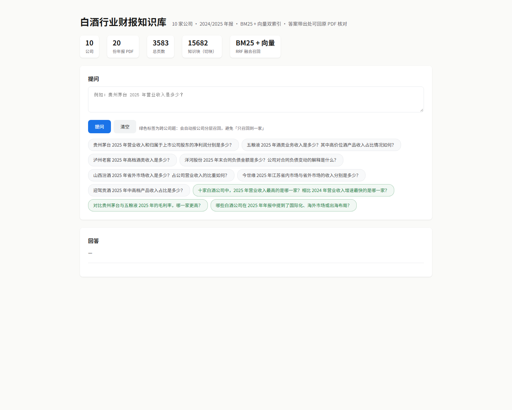
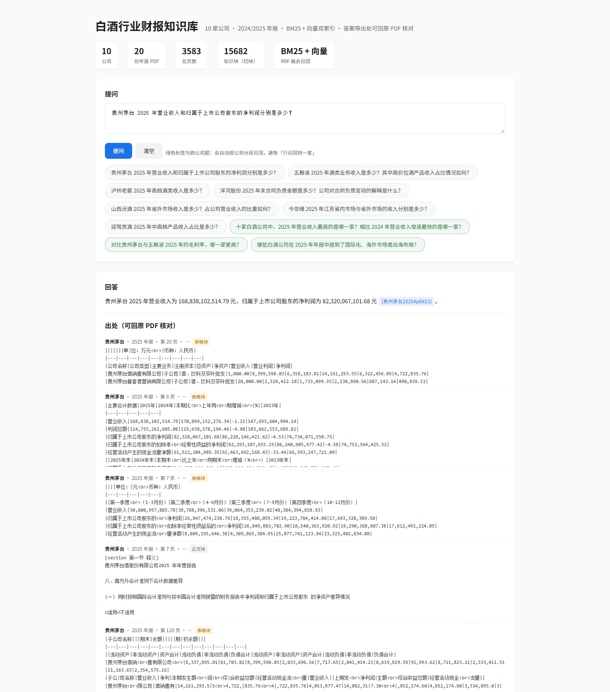
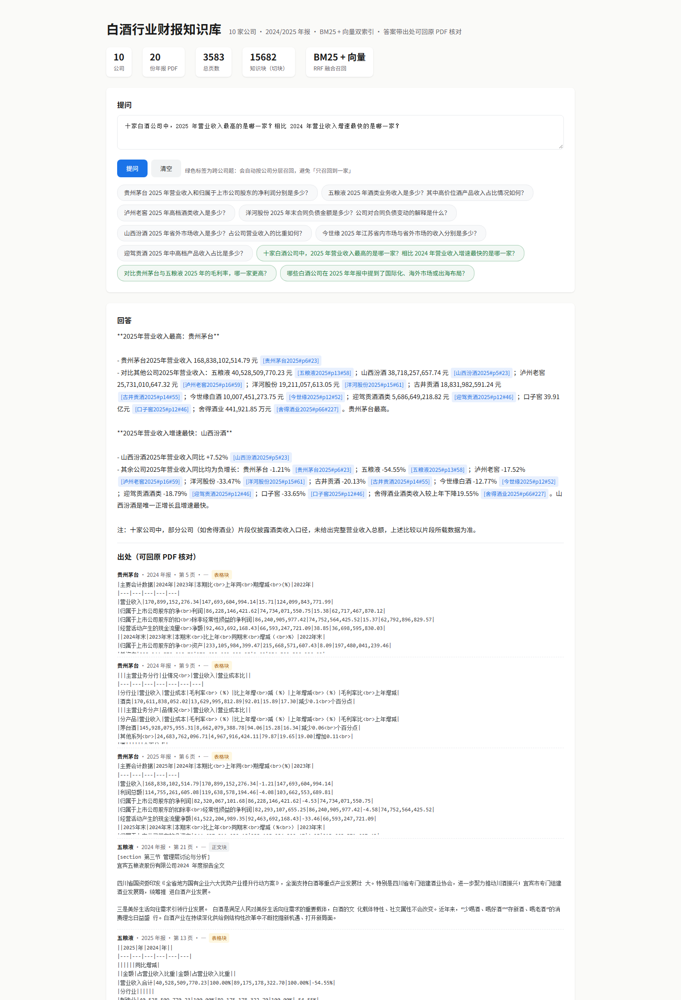

# 白酒行业财报知识库（作业 3 · 方向 A）

10 家白酒公司 × 2024/2025 年报（20 份 PDF / 3,583 页）→ 带出处的问答知识库。
答案里每个事实都带 `[公司#页码#块号]`，点开就能回原 PDF 核对。



## 效果

| | |
|---|---|
| 知识块 | 15,682（其中表格块 5,690，占 36%） |
| 召回 | BM25（CJK 二元组，自写）+ 向量（embedding-3）+ **字段命中**，三路 RRF 融合 |
| 问答 | DeepSeek 只依据召回片段作答，缺证据就说「资料中未提及」 |
| 跨公司题 | **分层抽样**：每家先各取 3 块再合并，避免「只召回到一家」 |
| 10 题结果 | 人工复核：9 题实质正确，1 题清单表述有瑕疵（见 `问答记录.md`） |




## 快速开始

```powershell
cd Repository\financial-kb
uv venv --python 3.14 .venv
uv pip install --python .venv\Scripts\python.exe -r requirements.txt
copy .env.example .env            # 填 LLM_KEY（问答）与 EMB_KEY（向量）

python download_reports.py        # ① 巨潮接口下 20 份年报 PDF
python extract_text.py            # ② PDF → 带页码/章节的 Markdown，表格按行列还原
python build_kb.py                # ③ 切块 + BM25 + 向量
python questions.py               # ④ 10 题逐题记录 → 问答记录.md
python tools/review_answers.py    # ⑤ 人工复核段写进 问答记录.md
serve.cmd                         # ⑥ 起问答页 http://127.0.0.1:8010
```

下载与建索引耗时（实测）：下载 ≈ 20 分钟、抽取 ≈ 20 分钟、向量化 ≈ 40 分钟（15,682 块，可断点续跑）。
起服务也可以挂到任务计划程序上（每天 08:30）：

```powershell
$dir = "E:\Work\Master\人工智能与数据分析\Repository\financial-kb"
$a = New-ScheduledTaskAction -Execute 'cmd.exe' -Argument ('/c ""' + $dir + '\serve.cmd""') -WorkingDirectory $dir
Register-ScheduledTask -TaskName '财报知识库服务' -Action $a `
  -Trigger (New-ScheduledTaskTrigger -Daily -At '08:30') -Force
schtasks /run /tn '财报知识库服务'
```

页面接口：
- `GET /` 问答页（可点示例题）
- `GET /ask?q=问题` **服务端渲染**的同一页（不用 JS，可分享、可截图）
- `GET /api/stats` 语料统计　`GET /api/health` 存活检查　`POST /api/ask` JSON 问答

## 目录

```
config.py            配置：公司列表 / 切块参数 / LLM / embedding
download_reports.py  ① 巨潮（cninfo）公开接口下载年报 PDF
extract_text.py      ② PDF → Markdown（页码 + 章节；表格按行列还原）
build_kb.py          ③ 切块 + BM25 + 向量 + 表格标签
qa.py                ④ 召回（三路 RRF + 分层抽样 + 年份加权）+ 生成带出处的答案
app.py               ⑤ 问答页（FastAPI；含服务端渲染 /ask）
questions.py         ⑥ 10 道测试题（3 道跨公司全景题）+ 逐题记录 + 模型考官
serve.cmd            起服务的脚本（纯 ASCII，任务计划程序调用）
tools/extract_key_metrics.py  从原文表格直读关键指标 → 人工基准表（核对答案用）
tools/review_answers.py        把人工复核写进 问答记录.md
问答记录.md / 结论.md  作业要求的「逐题记录」与「一页结论」
交付物/              问答页截图 3 张
```

## 踩坑清单（都在代码里修了，这里记原因）

1. **cninfo 查公告必须带 orgId**：`stock=代码,orgId`，只传代码永远返回 0 条；`pageSize` 上限 30，要翻页；
   年报在**次年** 3~4 月披露，要按披露年份检索。
2. **表格必须按行列还原**：`get_text()` 会把表格拍平成一行，数字对不上；这里用 `pymupdf4llm` 转 Markdown 表格，
   再把**行首指标名与列头**抽成标签，供第三路召回用。
3. **纯 BM25 在大库上会被高频词稀释**：先按公司/年份做实体过滤再排序；池确定后把公司名从查询里剔掉。
4. **RRF 别把名次当下标**（写错过一次，检索结果等于随机）。
5. **「资料中未提及」是红灯**：可能是没召回到，而不是资料真没有——第一轮 10 题里 2 题栽在这。
6. **同一指标多口径**：年报 MD&A 与附注（合同分类/母公司）数字不同，模型会当成矛盾；必须回原文核对口径。
7. **本机 HTTPS 解密**：Clash Verge 的自签根证书在 Windows 系统证书库里，Python 默认不认 →
   装 `truststore` 注入 ssl（不是关校验）。

## 安全

`.env`、年报 PDF、抽取文本、索引与向量文件全部在 `.gitignore` 里；仓库与截图不出现任何 key、账号、密码。
年报 PDF 只用于本课程，不外传。
